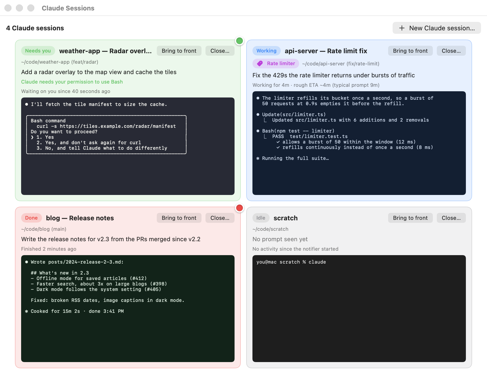
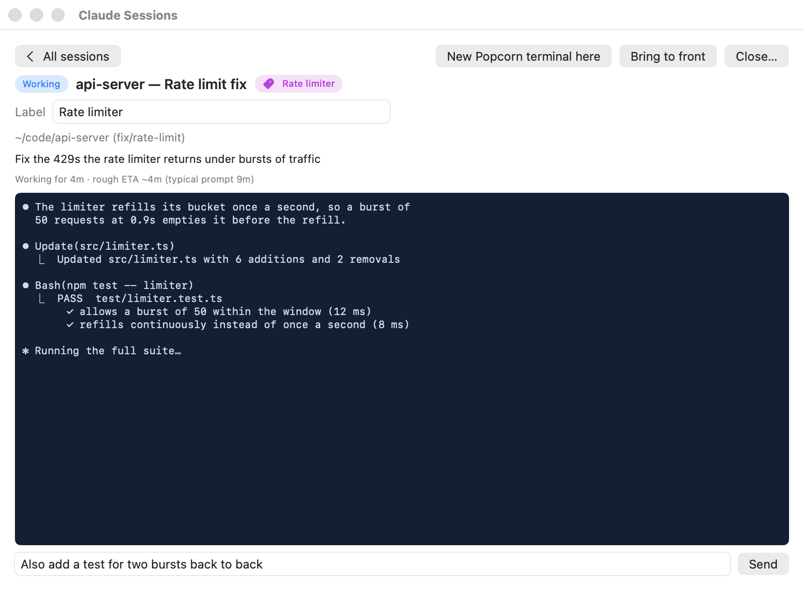
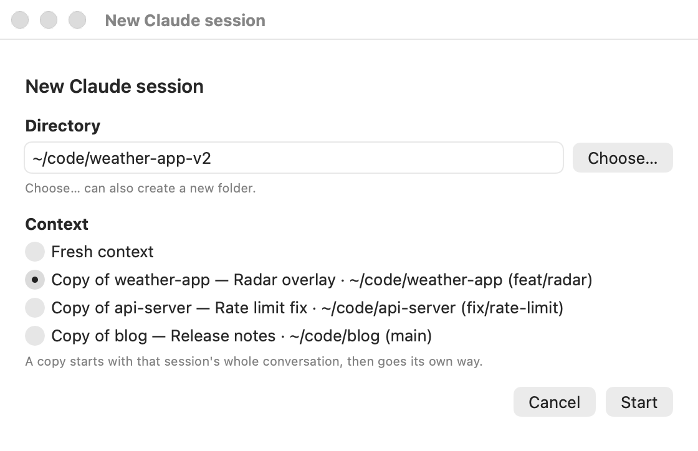

# Claude Notifier

Running several Claude Code sessions at once on one Mac means a lot of Terminal
windows, and it is easy to lose track of which one just finished, which is stuck
on a permission prompt, and what each is doing. Claude Notifier keeps track for
you.

It is a macOS menu bar app that follows every Claude Code session running in
Terminal on this machine:

- **It tracks Claude's notifications.** A red count shows sessions that have
  finished and are waiting for your next prompt; a green count shows sessions
  blocked on you mid-task, on a permission prompt or a question.
- **It helps you manage many Claude windows.** A dashboard shows every open
  session with its status, task and a live preview of its screen; brings the
  right Terminal tab to the front; lets you send a session a prompt; and starts
  new sessions, fresh or with a copy of another session's context.



*Screenshots are drawn from the app's own views with demo sessions.*

## The menu bar

`✳︎ Claude` sits in the menu bar with a red `●` count of finished sessions and a
green `●` count of sessions that need you. Click it for a list of them: each row
names the session by its folder and Terminal tab title, then its directory and
git branch, and hovering shows the full window name. Click a row to bring that
exact Terminal tab to the front.

A finished session's mark clears when you look at it: when you switch to its
window or tab, or, if it was already in front when it finished, when you next
click in it. A session that needs you stays green until you answer.

## The dashboard

Open it from the menu bar with **Open Dashboard…**. Every Claude session running
in Terminal gets a card, grouped by status and, within each group, most recently
prompted first:

| Status | Colour | Meaning |
| --- | --- | --- |
| Needs you | green | blocked on a permission prompt or a question |
| Working | blue | working on your last prompt |
| Done | red | finished its reply |
| Idle | grey | nothing new, or nothing seen since the notifier started |

What a session's screen shows counts too, for things no hook reports: a question
or permission prompt in place of Claude's input box (such as the ones Claude asks
while starting up) shows as **Needs you**, and a finished session whose footer
says background shells are still running shows as **Working**. A session never
prompted is ordered by when it was opened.

Each card shows the session's task (your last prompt), directory and branch, how
long it has been working, and a live preview of its screen in that terminal's
own colours, without Claude's input box. A card counted in the menu bar's
number carries a dot in its corner, red or green to match. The cards are sized
so they all fit in the window.

The **rough ETA** compares how long the session has been working with how long
your recent prompts took. Claude Code reports no progress, so treat it as a
guess.

### A closer look at one session

Click a card for a larger, live view of the session's scrollback.



From here you can:

- **label it** — type a name in the **Label** field, say "Rate limiter". It shows
  as a tag under the window's name on its card, and beside it here, and nowhere outside
  the dashboard. It is kept until you clear it: after restarts, when you
  resume the session, and after `/clear` in the same window;
- **Bring to front** — focus the session's Terminal tab;
- **send it a prompt** — type in the box at the bottom and press Send (or ⌘↩).
  It is typed into the session as if you had typed it there; if the session is
  busy, Claude queues it. Line breaks become spaces, since each would submit on
  its own;
- **New Popcorn terminal here** — open a plain shell in the session's directory
  (see [Popcorn windows](#popcorn-windows));
- **Close…** — exit Claude in that window and close it, after you confirm. The
  conversation is kept, and the confirmation shows the `claude --resume` command
  to reopen it. A window with other tabs, or still running something else, stays
  open. Cards have **Close…** too.

## Start a session with another session's context

You can start a new Claude session that begins with a copy of a running
session's whole conversation, in any directory, and then goes its own way. The
original session is not affected. Under the hood this is Claude Code's
`claude --resume <session-id> --fork-session`.



From the dashboard:

1. Open the dashboard and click **New Claude session…** at the top right.
2. Under **Directory**, type a path or click **Choose…**. The folder picker has a
   **New Folder** button if the directory doesn't exist yet.
3. Under **Context**, pick **Copy of …** the session whose conversation you want,
   or **Fresh context** for a new conversation.
4. Click **Start**. A new Terminal window opens in that directory, running Claude.

To check the copy really has the context, ask it about something only the
original conversation contains.

Every Claude session running in Terminal is listed under **Copy of …**: the
notifier reads each one's session id from Claude Code's record of its running
processes (`~/.claude/sessions/<pid>.json`).

From the command line:

```sh
# The latest session in the current directory
claude --continue --fork-session

# A particular session, from any directory
claude --resume <session-id> --fork-session

# The same, in a new Popcorn window
claude-fork <session-id> [directory]
```

Find a session's id with `/status` inside it, or pick from a list with
`claude --resume` (no id). Each session's transcript is
`~/.claude/projects/<its directory, slashes as dashes>/<session-id>.jsonl`.

Copies share your machine with the original: if both edit the same checkout,
give the copy its own git worktree. One copy holds one conversation; Claude Code
cannot merge several into one.

## Install

Needs macOS, Terminal.app, the Xcode command line tools (`swiftc`) and `jq`.

```sh
git clone https://github.com/CheyenneAtapour/claude-notifier.git
cd claude-notifier
./install.sh
```

This builds `~/.claude/notifier/Claude Notifier.app`, starts it at login, links
the hook and scripts from the repo, and adds the hooks to
`~/.claude/settings.json` (replacing earlier notifier hooks and keeping your
others). Run it again after changing the source. Sessions that were already
open pick up the hooks when Claude Code reloads its settings; if one doesn't,
run `/hooks` in it once.

macOS asks for two permissions:

- **Automation → Terminal**, to read tab titles and screens, focus tabs and send
  prompts;
- **Accessibility**, to notice a click inside a Terminal window. Without it,
  switching windows still clears marks.

The app is signed ad hoc, so macOS may ask again after a rebuild.

## How it works

`hook.sh` runs on Claude Code's hook events and keeps one JSON file per session
in `~/.claude/notifier/sessions/`:

| Event | Mode | State |
| --- | --- | --- |
| `UserPromptSubmit` | `prompt` | working, recording the prompt as the task |
| `Stop` | `done` | done (red) |
| `Notification`, `PreToolUse` on `AskUserQuestion` | `input` | needs you (green); the idle reminder is ignored |
| `PostToolUse` | `resume` | working again after you answered; a session with no record yet gets one, its task read from its transcript |
| `SessionEnd` | `end` | removed |

Each record also notes the session's terminal device, which the app matches
against Terminal's tabs (over AppleScript) for titles, previews, colours and
focus. Only sessions whose terminal still runs `claude` are shown. How long
finished prompts took goes to `~/.claude/notifier/history.jsonl` for the ETA;
errors go to `~/.claude/notifier/notifier.log`.

## Popcorn windows

`bin/popcorn-terminal [dir] [command]` opens a Terminal window with a random theme
from `$POPCORN_THEMES` (default
`~/Documents/github/random/macos-terminal-themes/themes`), in `dir`, optionally
running `command`. New sessions from the dashboard and `bin/claude-fork` use it.

## Screenshots

The images in `docs/` are drawn offscreen from the app's views with demo
sessions, so no real work appears in them. To redraw them after changing the UI:

```sh
swiftc -O ClaudeNotifier.swift -o /tmp/ClaudeNotifier && /tmp/ClaudeNotifier --screenshots docs
```

## Uninstall

```sh
launchctl bootout gui/$(id -u)/com.$USER.claude-notifier
rm ~/Library/LaunchAgents/com.$USER.claude-notifier.plist
rm -r ~/.claude/notifier ~/.claude/bin/popcorn-terminal ~/.claude/bin/claude-fork
```

Then remove the `notifier/hook.sh` entries from `~/.claude/settings.json`.
